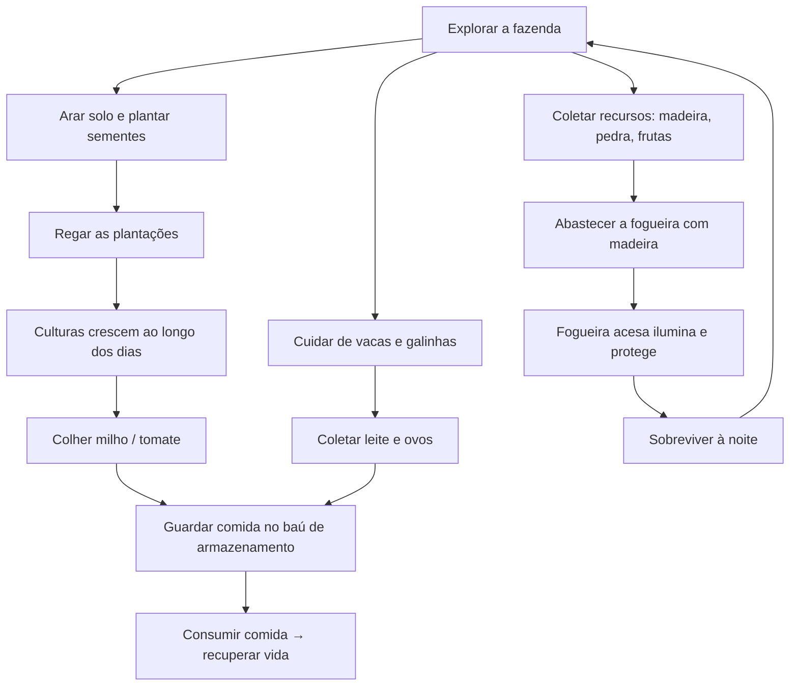
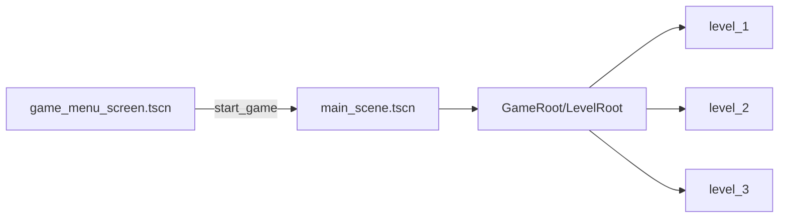

# Fallen Realm 2 — Game Design Document (GDD)

> **Versão do documento:** 1.0
> **Data:** 2026-10-13
> **Status do projeto:** Protótipo jogável (vertical slice)
> **Documento base:** escrito a partir do estado atual do código (Godot 4.7 / Mobile).
>
> Este GDD reflete **o que já existe implementado** no repositório, não apenas intenções.
> Onde algo é planejado mas ainda não implementado, está marcado como 🚧 **Planejado**.

---

## 1. Visão Geral

| Item | Valor |
|---|---|
| **Título** | Fallen Realm 2 |
| **Gênero** | Fazenda / Sobrevivência / Ação (top-down 2D) |
| **Engine** | Godot 4.7 |
| **Plataforma-alvo** | Desktop e **Mobile** (`config/features = ["4.7", "Mobile"]`, renderizador `mobile`) |
| **Resolução base** | 1920×1080 (viewport), janela 1152×648, stretch `viewport` + `expand` |
| **Câmera** | `Camera2D` filha do Player (segue o jogador) |
| **Idioma** | Português (pt-BR) |
| **Diretório no projeto** | `res://` |

### 1.1 High Concept
Um jogo de fazenda onde o jogador cultiva, cria animais e coleta recursos de dia — mas
precisa **sobreviver à noite**, quando criaturas surgem e um **Necromante** aparece para
invocar monstros. A gestão diurna de recursos (comida, madeira, combustível) é a moeda de
sobrevivência contra os perigos noturnos.

### 1.2 Pilares de Design
1. **Ciclo diurno produtivo** — plantar, colher, coletar e cuidar dos animais.
2. **Tensão noturna** — a escuridão traz inimigos; a fogueira e a comida mantêm o jogador vivo.
3. **Sobrevivência pela gestão** — a fome reduz a vida continuamente; recursos combatem isso.
4. **Comunicação indireta** — sistemas desacoplados via `EventBus` (arquitetura orientada a eventos).

---

## 2. Loop de Jogo



**Ciclo central:** produzir de dia → acumular recursos → consumir/guardar → sobreviver à noite → repetir.

---

## 3. Controles (Input Map)

| Ação | Tecla / Botão | Observação |
|---|---|---|
| `walk_up` / `walk_down` / `walk_left` / `walk_right` | `W`/`S`/`A`/`D` ou setas | Movimento do jogador |
| `hit` | **Clique direito** | Ação principal da ferramenta equipada (usar/atacar) |
| `remove_dirt` | **Ctrl + Clique direito** | Remove terra arada / devolve recurso |
| `interact` | `I` | Interagir com objetos próximos (fogueira, baús) |
| `show_dialogue` | `E` | Iniciar diálogo com NPCs |
| `save_game` | `P` | Salvar o jogo |
| `mute` | `M` | Alterna mute global (`AudioManager.toggle_mute`) |
| `game_menu` | *(ver `project.godot`)* | Abre o menu do jogo (para todos os áudios) |
| `0` / `1` / `2` / `3` | *(dev)* | Trocar nível / recarregar (atalhos de desenvolvimento) |

> Os atalhos de nível (`SceneManager.debug_shortcuts_enabled`) e a constante
> `DEV_START_LEVEL` são **apenas para desenvolvimento**.

---

## 4. Sistemas de Jogo

### 4.1 Vida e Fome (HP)
- Player tem `max_health = 100.0`.
- A cada **tique do relógio** do jogo (`DayAndNightCycleManager.time_tick`, de minuto em minuto)
  o jogador **perde 0.1 de vida** (`player.gd → _on_time_tick`). Isso simula a **fome**.
- Comer / coletar certos itens recupera vida.
- Ao chegar a 0: `morrer_de_fome()` → emite `EventBus.player_died`, marca `is_dead` e para a física.
- A vida é refletida na UI via sinal `player_health_changed` (`health_bar.tscn`).

### 4.2 Ciclo Dia/Noite
- `DayAndNightCycleComponent` (`CanvasModulate`) + autoload `DayAndNightCycleManager`.
- `initial_hour` / `initial_minute` definidos em `main_scene.tscn`.
- Gradiente 1D define as cores; matemática:
  - $time = minutos \times \dfrac{TAU}{1440}$
  - $sample = 0.5 \times (\sin(time - \pi/2) + 1)$
- Emite `time_tick(day, hour, minute)` (usado pela fome do player e pelo crescimento das plantas) e `time_tick_day` (avanço de dia, usado pelas culturas).
- À noite, o guia (Marlow) avisa para cortar lenha e alerta sobre os monstros (`guide_night_warning.dialogue`).

### 4.3 Ferramentas
Enum `DataTypes.Tools`:

| Valor | Ferramenta | Função |
|---|---|---|
| 0 | `None` | Nenhuma |
| 1 | `AxeWood` | Cortar árvores **e quebrar rochas** |
| 2 | `TillGround` | Arar solo |
| 3 | `WaterCrops` | Regar plantações |
| 4 | `PlantCorn` | Plantar milho |
| 5 | `PlantTomato` | Plantar tomate |
| 6 | `Crossbow` | Besta — atacar à distância (flecha) |
| 7 | `BuildRock` | Construir barreira de pedra |

> ⚠️ **Não existe picareta:** rochas são quebradas com o machado (`tool = AxeWood`).
- Ferramenta equipada vive em `ToolManager.selected_tool`; o Player escuta `tool_selected` e
  repassa para o `HitComponent.current_tool`.
- UI: `tools_painel.tscn` (botões com `theme_type_variation = ToolButton`).

### 4.4 Coleta de Recursos
Fluxo de dano/coleta (desacoplado por camadas de colisão):

```
HitComponent (layer Tool) → HurtComponent (valida tool == current_tool)
    → emite hurt(damage) → objeto aplica dano → atinge max_damage
    → spawna drop (Collectable) + queue_free
CollectableComponent (Area2D Collectable ↔ Player) → InventoryManager.add_collectable(nome)
```

- Rocha (`rock.gd`) → dropa `stone`; Árvore (`small_tree.gd`/`large_tree.gd`) → `log` (madeira).
- **Coletáveis existentes:** `wood`, `stone`, `egg`, `milk`, `corn`, `tomato` (e maçãs `apple`).
- Animais (vaca/galinha) produzem coletáveis e **também curam o player**.
- Som do acerto fica no `on_hurt` do objeto: `AudioManager.play_sfx_at(AXE_HIT|PICKAXE_HIT, ...)`.

### 4.5 Plantio e Culturas
- Fluxo: **arar** (`TillGround` + `hit`) → pisar no solo arado com semente → **plantio automático**
  (`crop_cursor_component.gd → _auto_plant_if_on_tilled_soil`).
- `GrowthCycleComponent` controla crescimento: `is_watered`, `starting_day`, evolução pelos dias.
- Estados de crescimento (`DataTypes.GrowthStates`): Germination → Seed → Vegetative → Reproduction → Maturity → Harvesting.
- Regar (`WaterCrops` + `hit`) faz `on_hurt` da planta marcar `is_watered = true`.
- Colheita (`on_crop_harvesting`) gera o item correspondente.
- Regras:
  - Plantas **pré-plantadas** começam com `is_watered = true` (crescem sozinhas).
  - Plantas **do jogador** recebem `is_watered = false`.
  - Solo sem água não avança o crescimento.
- Culturas atuais: **milho** (`corn.gd`) e **tomate** (`tomato.gd`).
- Pré-plantadas no Level 1: `CropFields/Corn`, `Corn2`, `Corn3`.
- O guia Marlow lembra o jogador de regar (`watering_reminder_delay`) e libera o regador.

### 4.6 Interação por Proximidade
- `InteractableComponent` (Area2D) emite `interactable_activated` / `interactable_deactivated`.
- Padrão: entidade detecta proximidade → emite `EventBus.show_action_prompt(key, label)` →
  player pressiona `I` → ação executa.
- **Objetos interativos:** fogueira, baús, solo arado (prompt de sacola de sementes / aviso de ferramenta).

### 4.7 Fogueira (`Campfire`)
- `max_fuel = 100`, `fuel_drain_rate = 0.2/s`, `fuel_per_wood = 25`.
- **Não usa diálogo** — usa ActionPrompt: perto + tem `wood` → `[I] Abastecer` → consome 1 madeira → +25 combustível.
- Se a madeira acabar, o prompt some (`inventory_changed`).
- Barra de combustível laranja (`WorldHealthBar`), `hide_when_full = true`.
- Emite `campfire_lit` / `campfire_died` / `campfire_fuel_changed`; ilumina via `PointLight2D`.

### 4.8 Animais
- `NonPlayableCharacter` base; vacas (`cow.gd`) e galinhas (`chicken.gd`).
- Usam `NavigationRegion2D` (pastagens) e pastam aleatoriamente.
- `AnimalSoundComponent`: som ambiente com timer/chance (ex.: vaca muge a cada 20–40s, 20% de chance).
- Produzem `milk` / `egg`; coletá-los cura o player.
- Alimentação via diálogo: ação `GameDialogueManager.action_feed_animals()`.

### 4.9 Inventário e Armazenamento
`InventoryManager` (autoload):

| Conceito | API |
|---|---|
| Inventário (mochila) | `add_collectable(nome)`, `remove_collectable(nome)`, `get_inventory_count(nome)` |
| Armazenamento (baús) | `add_to_storage(item, qtd)`, `remove_from_storage(item, qtd)`, `get_stored_amount(item)` |
| Sinais | `inventory_changed`, `storage_changed` |

- Baús de armazenamento (milho/tomate) via diálogo (`storage_chest.dialogue`):
  **Guardar** / **Retirar** / **Sair** → `action_store_item("corn")` / `action_withdraw_item(...)`.

### 4.10 Inimigos e Combate
- Classe base `Enemy` (`enemy.gd`) com **máquina de estados**:

```
Idle → Chase → Attack
```

| Parâmetro | Descrição |
|---|---|
| `max_health` | Vida do inimigo |
| `chase_speed` | Velocidade de perseguição |
| `chase_distance` | Distância para iniciar perseguição |
| `attack_distance` | Distância para atacar |
| `attack_cooldown` | Intervalo entre ataques |
| `enemy_type` | Registro/comportamento especial |

- Filhos obrigatórios da cena: `HitComponent`, `HurtComponent`, `PortalSpawnComponent`, `AnimatedSprite2D`.
- **Spawn com portal:** `PortalSpawnComponent.play_spawn()`; colisões/física desabilitadas durante o spawn.
- Barra de vida criada em código (`_create_health_bar()`), vermelha.
- **Knockback:** ao ser atingido, o alvo recebe impulso oposto (`aplicar_knockback`).
- **Player ataca** com `Crossbow` (flechas/`arrow.tscn`) e com golpes de ferramenta.

### 4.11 Chefe — Necromante
- Inimigo especial (`necromante.tscn`), `enemy_type = "Necromante"`, `chase_speed = 30`, `chase_distance = 250`, `attack_distance = 100`.
- Estado especial **Boss Summon** (`boss_summon_state.gd`): invoca inimigos menores ao redor com
  efeito de portal.
  - `summon_scenes`, `summon_count = 1`, `spawn_offsets`, `summon_delay = 1.5`, `spawn_interval = 0.4`.
  - `max_summon_cycles` limita quantas vezes pode invocar; ao esgotar, chama `enemy.desaparecer()`
    (portal + fade, sem dano).
- Aparições registradas globalmente em `NecromancerRegistry`:
  - `register_appearance()`, `get_total_appearances()`.
  - Sinais: `necromancer_appeared(total)`, `necromancer_vanished(total)`.

### 4.12 Construção de Barreiras (`RockBarrier`)
- Ferramenta `BuildRock` + `RockBarrierCursorComponent`.
- **Construir:** `hit` coloca barreira na célula de grama próxima (dist < 20 px), consome 1 `stone`.
- **Remover:** `remove_dirt` (Ctrl + clique) remove e devolve o recurso.
- `rock_barrier.tscn`: `StaticBody2D` (layer Ground) + `HurtComponent` (tool = AxeWood) +
  `DamageComponent` (max_damage = 3) + `SaveDataComponent`.
- Container estático `RockBarriers` no nível (necessário para o save/load).

### 4.13 Diálogo
- Addon `addons/dialogue_manager/`; balloon custom em `dialogue/game_dialogue_balloon.tscn`.
- Conversas em `dialogue/conversations/*.dialogue`:

| Arquivo | Conteúdo |
|---|---|
| `guide.dialogue` | Marlow apresenta o plantio e entrega a semente de milho |
| `guide_night_warning.dialogue` | Aviso noturno (cortar lenha / monstros) |
| `chest.dialogue` | Baú genérico |
| `storage_chest.dialogue` | Depósito de milho/tomate (guardar/retirar) |
| `campfire.dialogue` | Fogueira |
| `test.dialogue` | Teste |

- **Ações de diálogo** (`GameDialogueManager`, chamadas via `do GameDialogueManager.action_xxx()`):
  - `action_give_crop_seed()` → `give_crop_seeds`
  - `action_feed_animals()` → `feed_the_animals`
  - `action_store_item(item)` → `store_item`
  - `action_withdraw_item(item)` → `withdraw_item`
  - `action_add_fuel_to_campfire()` → `add_fuel_to_campfire`
- Ação `mute` (tecla `M`) é tratada pelo `GameManager` em qualquer tela.
- Recompensa só marca a quest como concluída quando entregue de fato (permite re-conversar).

### 4.14 Áudio
`AudioManager` (autoload) — enums `SFX` + `SFX_PATHS` e `MUSIC` + `MUSIC_PATHS`.

| Função | Uso |
|---|---|
| `play_sfx(id, vol_db)` | SFX global |
| `play_sfx_at(id, pos, vol_db)` | SFX posicional |
| `play_sfx_pitched` / `play_sfx_varied_at` | SFX com variação |
| `play_music(id, vol_db, pitch)` / `stop_music()` | Música (bus Music) |
| `toggle_mute()` | Mute global (bus Master) |

- Buses: **Music** `-0.92 dB`, **SFX** `-2.31 dB` (`game_audio_bus_layout.tres`).
- Componentes: `SFXComponent` (attack/summon/footstep) e `AnimalSoundComponent`.
- Arquivos: `game/assets/audio/sfx/*.ogg` e `game/assets/audio/music/*`.

### 4.15 Save / Load
- `SaveGameManager` (autoload): `save_game()` (tecla `P`), `load_game()`, `delete_all_saves()`.
- Usa `SaveLevelDataComponent` (grupo `save_level_data_component`) presente em cada nível.
- `SaveDataComponent` por objeto persistente (ex.: barreiras, solo arado).
- Dados salvos em `user://game_data/` (`save_*.tres`).
- `GameManager.start_game()` → `SceneManager.start_game()` + `SaveGameManager.load_game()`, depois habilita o save.

### 4.16 UI / HUD
| Elemento | Arquivo | Descrição |
|---|---|---|
| Barra de vida do player | `scenes/ui/health_bar.tscn` | Escuta `player_health_changed` |
| Painel de ferramentas | `scenes/ui/tools_painel.tscn` | Botões de ferramenta |
| Inventário | `scenes/ui/inventory_panel.tscn` | Itens coletados |
| Painel dia/noite | `scenes/ui/day_and_night_panel.tscn` | Relógio/hora |
| Action Prompt | `scenes/action_prompt.tscn` | Texto `[tecla] ação`, clique, sacola, aviso |
| Tela de jogo | `scenes/ui/game_screen.tscn` | HUD principal |
| Menu do jogo | `scenes/ui/game_menu_screen.tscn` | `run/main_scene` |
| Barra de vida no mundo | `scenes/components/world_health_bar.tscn` | Inimigos/fogueira |

**Action Prompt — sinais do EventBus:**
- `show_action_prompt(key, label)` / `hide_action_prompt`
- `show_seed_bag` (ícone de sacola de sementes no solo arado)
- `show_click_animation` (animação de clique)
- `show_action_warning(label)` (aviso de ferramenta errada)

---

## 5. Personagens

| Personagem | Papel | Detalhes |
|---|---|---|
| **Player** | Protagonista | `CharacterBody2D` + máquina de estados (Idle, Walk, Chopping, Tilling, Watering, Crossbow) |
| **Marlow** (Guide) | Tutorial / lore | `guide.gd`; entrega sementes, avisa sobre a noite, lembra de regar |
| **Vaca (Cow)** | Animal de produção | Produz leite; navega na pastagem |
| **Galinha (Chicken)** | Animal de produção | Produz ovos; navega na pastagem |
| **MushMario / Mushrooms** | Inimigo comum | Invocado pelo Necromante |
| **Necromante** | Chefe | Invoca monstros; registra aparições |

### 5.1 Estados do Player
`IdleState`, `WalkState`, `ChoppingState`, `TillingState`, `WateringState`, `CrossbowState`
+ `PlayerHurtComponent` (recebe dano).

---

## 6. Níveis

| Nível | Cena | Conteúdo |
|---|---|---|
| **Level 1 — Fazenda** | `level_1.tscn` | Sem inimigos. Grama, solo arado, milhos pré-plantados, árvores, rochas, baú, fogueira, maçãs, fazenda com **vacas** e **galinhas**, Marlow, barreiras de pedra |
| **Level 2 — Necromante** | `level_2.tscn` | Introduz o **Necromante** (chefe) e invocação de **Mushrooms**; coleta de ovos/leite |
| **Level 3 — ?** | `level_3.tscn` | Novo inimigo 🚧; casa pequena, curral, animais livres (`FreeAnimals`) |

**Navegação:** `SceneManager.DEV_START_LEVEL` (0/1/2) define o nível inicial (dev). Teclas `1/2/3` trocam.
A `main_scene.tscn` é um contêiner persistente; o nível é carregado em
`/root/MainScene/GameRoot/LevelRoot`, mantendo HUD, player e sistemas globais intactos.



---

## 7. Arquitetura Técnica

### 7.1 Autoloads (ordem em `project.godot`)
| Ordem | Autoload | Arquivo | Responsabilidade |
|---|---|---|---|
| 1 | `ToolManager` | `scripts/globais/tool_manager.gd` | Ferramenta equipada |
| 2 | `InventoryManager` | `scripts/globais/inventory_manager.gd` | Inventário + storage |
| 3 | `SaveGameManager` | `scripts/globais/save_game_manager.gd` | Save/Load |
| 4 | `DialogueManager` | `addons/dialogue_manager/` | Sistema de diálogo |
| 5 | `GameDialogueManager` | `scripts/globais/game_dialogue_manager.gd` | Ações de diálogo |
| 6 | `GameManager` | `scripts/globais/game_manager.gd` | Start/exit/menu |
| 7 | `DayAndNightCycleManager` | `scripts/globais/day_and_night_cycle_manager.gd` | Ciclo dia/noite |
| 8 | `EventBus` | `scripts/globais/EventBus.gd` | Sinais globais |
| 9 | `AudioManager` | `scripts/globais/audio_manager.gd` | Áudio |
| 10 | `NecromancerRegistry` | `scripts/globais/necromancer_registry.gd` | Aparições do Necromante |
| 11 | `SceneManager` | `scenes/scene_manager.gd` | Troca de cenas/níveis |

### 7.2 Comunicação — `EventBus`
> **Regra de ouro:** sistemas comunicam **sempre** via `EventBus`, nunca por referência direta.

Sinais principais:
- `player_health_changed(current, max)`, `player_died`
- `campfire_lit`, `campfire_died`, `campfire_fuel_changed(fuel, max)`
- `show_action_prompt(key, label)`, `hide_action_prompt`
- `show_seed_bag`, `show_click_animation`, `show_action_warning(label)`

### 7.3 Componentes Reutilizáveis (`scenes/components/`)
`HitComponent`, `HurtComponent`, `DamageComponent`, `FeedComponent`, `CollectableComponent`,
`InteractableComponents`, `SaveDataComponent`, `SaveLevelDataComponent`, `WorldHealthBar`,
`DayNightCycleComponent`, `SfxComponent`, `AnimalSoundComponent`, `PortalSpawnComponent`,
`FieldCursorComponent`, `CropCursorComponent`, `RockBarrierCursorComponent`, `MouseCursorComponent`.

### 7.4 Camadas de Colisão
**Física (`project.godot`):**
| Bit | Nome |
|---|---|
| 1 | Ground |
| 2 | Player |
| 4 | Interactable |
| 8 | Tool |
| 16 | Object |
| 32 | Collectable |
| 64 | NPC |
| 128 | Food |

**Uso no jogo (convenção da memória do repo):**
1 World · 2 Player · 4 Enemy/PlayerAttack · 8 HitComponent · 16 HurtComponent/Feed ·
32 Collectable · 64 Animals · 128 Plants · 256 Interactable

### 7.5 Convenções de Código
- **Classes:** PascalCase · **Funções/variáveis:** snake_case · **Privados:** `_prefixo`.
- **Sinais:** snake_case no passado (`player_died`, `tool_selected`).
- **Constantes:** `UPPER_SNAKE_CASE` · **Nós na cena:** PascalCase · **Grupos:** snake_case minúsculo.
- **Máquina de estados:** estados estendem `NodeState` com `_on_enter`, `_on_exit`, `_on_process`, `_on_physics_process`, `_on_next_transitions`.
- **Debug:** emoji + `[SISTEMA]` (ex.: `👹[ENEMY]`, `🔥[CAMPFIRE]`, `🎵[AUDIO]`).

---

## 8. Assets

| Categoria | Local |
|---|---|
| Sprites de UI | `game/basic_ui_sprit.png`, `game/assets/` |
| Sprites de plantas | `game/assets/` (`basic_plants.png`) + `scenes/objects/plants/` |
| Sprites de personagens/inimigos | `game/assets/characters/enemy/` |
| SFX | `game/assets/audio/sfx/*.ogg` |
| Música | `game/assets/audio/music/*` |
| Tilesets | `tileset/game_tile_set.tres`, `tileset/house_tile_set.tres` |
| Ícone | `icon.svg` |

---

## 9. Estado de Desenvolvimento e Roadmap

### ✅ Implementado
- Movimento + máquina de estados do player (caminhar, cortar, arar, regar, besta).
- Sistema de dano/knockback (Hit/Hurt/Damage components).
- Coleta de recursos (árvore, rocha) e coletáveis (madeira, pedra, ovo, leite, milho, tomate, maçã).
- Plantio (arar → plantar → regar → colher) com crescimento por dias.
- Animais (vaca/galinha) com navegação e sons.
- Ciclo dia/noite + fome (perda contínua de vida).
- Fogueira com combustível e luz.
- Inventário + armazenamento em baús.
- Diálogo com ações (sementes, alimentar animais, armazenar/retirar).
- Inimigos com IA (Idle/Chase/Attack) e spawn por portal.
- Chefe Necromante com invocação e registro de aparições.
- Barreiras de pedra construíveis.
- Áudio centralizado (SFX + música + mute global).
- Save/Load por nível.
- UI (vida, ferramentas, inventário, dia/noite, action prompt).

### 🚧 Planejado / A fazer (baseado em `docs/TODO.md`)
- **Level 3:** novo inimigo (ainda não criado).
- Ajustes contínuos de balanceamento (dano, vida, velocidades).
- Consolidação de assets/arte (escala de árvores, backgrounds).

---

## 10. Referências
- `AGENTS.md` — guia rápido de arquitetura.
- `docs/TODO.md` — histórico de mudanças e próximos passos.
- `docs/AUDIO_SYSTEM.md`, `docs/DAMAGE_SYSTEM_SETUP.md`, `docs/KNOCKBACK_SYSTEM.md`, `docs/RESOURCE_GATHERING.md`.
- Memória do repositório: convenções detalhadas.
